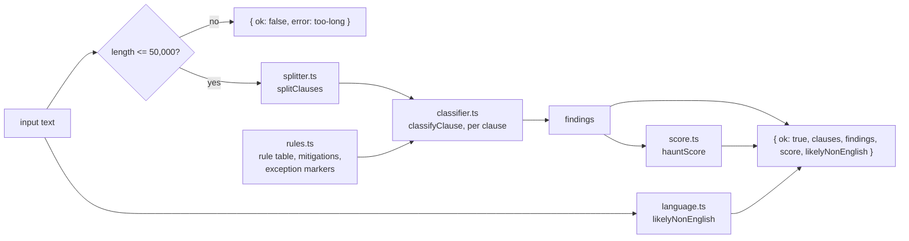

# Design: clause-analyzer

## Overview

The analyzer is a set of pure TypeScript modules in `src/lib/analyzer/`. `analyze(text)` checks the size cap, splits the text into clauses, classifies each clause against a rule table, computes the Haunt Score and sets a non-English flag. It runs in the browser, reads no clock, uses no randomness, makes no network call and keeps no state.

Requirements: `.kiro/specs/clause-analyzer/requirements.md` (R1–R11 below; "R3.2" means Requirement 3, criterion 2). Decisions: PLAN_DECISIONS.md C1.7, C1.10, C4, C7 and C10.



## Files

| File | Contents | Requirements |
| --- | --- | --- |
| `src/lib/analyzer/types.ts` | Types below | all |
| `src/lib/analyzer/rooms.ts` | `ROOMS`: the eight rooms in order, with ID, name, clause type | R10 |
| `src/lib/analyzer/splitter.ts` | `splitClauses(text): Clause[]` | R1 |
| `src/lib/analyzer/rules.ts` | `RULES`, `MITIGATIONS`, `EXCEPTION_MARKER` | R2, R3 |
| `src/lib/analyzer/classifier.ts` | `classifyClause(clause, input): Finding \| null` | R2, R3, R4 |
| `src/lib/analyzer/score.ts` | `hauntScore(findings): number`, weights | R5 |
| `src/lib/analyzer/language.ts` | `likelyNonEnglish(text): boolean`, common-word list | R9 |
| `src/lib/analyzer/analyze.ts` | `analyze(text): AnalyzeResult`, `MAX_INPUT_LENGTH = 50_000` | R6, R7, R8 |
| `src/lib/analyzer/index.ts` | Public exports | all |
| `src/lib/samples/{mild,average,terrible}.ts`, `index.ts` | The three fictional samples | R11 |

Tests sit next to each file (see "Testing").

## Types

```ts
export type RoomId =
  | "cellar" | "portraits" | "vault" | "locked-door"
  | "court" | "mirror" | "trapdoor" | "stairs";
export type Severity = 0 | 1 | 2 | 3;

export interface Room { id: RoomId; name: string; clauseType: string }

export interface Clause { id: string; start: number; end: number; text: string } // text === input.slice(start, end)

export interface Finding {
  id: string;              // clause ID, "c-<start>"
  room: RoomId;
  severity: Severity;
  quote: string;           // === input.slice(start, end), trimmed span
  start: number;
  end: number;
  ruleId: string;
  mitigationId: string | null;
  explanation: string;     // from the rule, 1..400 chars
  whyItMatters: string;    // from the rule, 1..400 chars
}

export type AnalyzeResult =
  | { ok: true; clauses: Clause[]; findings: Finding[]; score: number; likelyNonEnglish: boolean }
  | { ok: false; error: { code: "too-long"; length: number; limit: 50000 } };
```

## Splitter (R1)

### Algorithm

The splitter makes one pass over the text and collects candidate boundary offsets, then resolves them.

1. **Terminator candidates (R1.7).** Each match of `[.;?!][)\]"'”’]*(?=\s)` gives a candidate at the end of the following whitespace run, unless one of these holds:
   - The `.` is the last character of a listed abbreviation that is not preceded by a letter (R1.10). The check looks backwards from the `.` for `e.g.`, `i.e.`, `Inc.`, `Ltd.`, `Co.`, `Corp.`, `U.S.`, `No.`, `Sec.`, `etc.` or `vs.` (and the capitalised forms `E.g.`, `I.e.`, `Etc.`, `Vs.`), then checks that the character before the abbreviation is not `\p{L}`. So `Acme Inc. is` does not split, and `zinc. Then` does split.
   - The `.` belongs to a list marker at the start of its line (`1. `, `12. `), as R1.7 now states.
2. **Paragraph-break candidates (R1.8).** Each whitespace run that contains `\n[ \t]*\n` or `\r\n[ \t]*\r\n` (or a mix) gives a candidate at the end of that run. This applies even after an abbreviation (R1.11).
3. **List-marker candidates (R1.9).** Each line start (offset 0, or just after `\n`) followed by `[ \t]*` and a marker (`[-*•]`, `\d{1,3}[.)]`, `[A-Za-z]\)` or `\([A-Za-z0-9]{1,4}\)`), and then `[ \t]`, gives a candidate at the marker's first character.
4. **Resolution (R1.13).** Every candidate that lies inside a whitespace run, or at its edge, moves to the end of that run. Candidates equal to `0` or `text.length` are dropped. Duplicates are removed and the rest sorted.
5. **Clauses.** Consecutive boundaries define clauses: `[0, b1)`, `[b1, b2)`, …, `[bn, text.length)`. The ID is `c-<start>`. Empty input gives `[]`.

### Boundary resolution: which rule wins

When an indented list item follows a paragraph break, both R1.8 and R1.9 fire. **R1.8 wins.** There is one boundary, at the end of the whole whitespace run, which is exactly at the list marker. The indentation stays at the end of the previous clause as trailing whitespace, and quotes trim it away (R4.2). The same snapping applies when a list item follows a single line break, or a terminator, so every clause after the first starts with a non-whitespace character. This also makes R1.5 hold by construction: no whitespace-only clause can exist between two boundaries in the same run.

| Input (`·` = space, `⏎` = `\n`) | Boundaries | Clauses |
| --- | --- | --- |
| `Intro.⏎⏎··-·Item one.` | 10 (end of `⏎⏎··`) | `Intro.⏎⏎··` and `-·Item one.` |
| `We collect:⏎··-·email⏎··-·name` | 14 and 24 (each marker) | `We collect:⏎··`, `-·email⏎··`, `-·name` |
| `1.·We collect data.⏎2.·We share it.` | 20 (terminator and list marker snap to the same place) | `1.·We collect data.⏎` and `2.·We share it.` (neither `1.` nor `2.` splits, because both are list markers) |
| `We, etc.⏎⏎Next part.` | 10 (paragraph break) | `We, etc.⏎⏎` and `Next part.` |

### Known trade-offs (no characters are ever lost)

- `No.` and `U.S.` never end a clause, so "…the answer is No. Then…" and "…based in the U.S. We collect…" stay as one clause. A finding still quotes exact input; it is just a longer quote.
- An ellipsis followed by a space (`... `) ends a clause.
- A number like `2.` in the middle of a line (not at a line start) is not a list marker, so `…data. 2. We…` gives a short clause `2. `. It holds no finding, and no text is lost.

## Classifier (R2, R3, R4)

### Algorithm for one clause

1. Trim the clause to its non-whitespace span `[s, e)`. If it is empty, return `null` (R2.3).
2. For each room in room order, find every rule of that room whose pattern matches `input.slice(s, e)`. The room's raw severity is the highest of their severities. Its `ruleId` is the first rule in the table with that severity (R2.5, R3.1).
3. For each matching mitigation of that room (in table order), find its first match. Look for an exception marker in the text after the end of that match. If there is none, the mitigation applies (R3.2–R3.5). The applicable mitigation with the lowest level wins; ties go to the first in the table. If its level is lower than the room's severity, the severity becomes that level and `mitigationId` is set (R3.6). Otherwise `mitigationId` stays `null`.
4. Choose the room with the highest severity after mitigations. Ties go to the room that comes first in room order (R2.4).
5. Build the finding: `id` = clause ID, `start = s`, `end = e`, `quote = input.slice(s, e)`, plus `explanation` and `whyItMatters` from the rule (R4). A severity 0 result is still a finding (R3.7).

All patterns use the `i` flag (R2.8), and the flags never include `g` or `y`, so no `lastIndex` state leaks between calls (R7.3). Gaps between words use `[^.;]{0,N}` with a fixed `N`, so matching stays linear in the clause length (R6.3).

`EXCEPTION_MARKER = /\b(?:except|unless|other than|however|provided that|but|although|subject to)\b/i` (R3.8, C10.2).

### Rule table (`rules.ts`)

`G` stands for `[^.;]`. Explanation and "why it matters" texts are written per rule in plain English, each at most 400 characters (R4.5). Example for `cellar.sell`: "This clause lets the company sell what it knows about you." / "Once your data is sold you cannot see or control who holds it next."

| Room | Rule ID | Sev | Pattern (case-insensitive) |
| --- | --- | --- | --- |
| Cellar | `cellar.sell` | 3 | `\bsell(s\|ing)?\b G{0,60} \b(data\|information\|details)\b` |
| Cellar | `cellar.sold` | 3 | `\b(data\|information\|details)\b G{0,40} \b(be \|is \|are )?sold\b` |
| Cellar | `cellar.broker` | 3 | `\bdata brokers?\b` |
| Cellar | `cellar.ad-partners` | 3 | `\b(share\|disclose\|provide\|transfer)\w*\b G{0,80} \badvertis\w*\s+partners?\b` |
| Cellar | `cellar.third-parties` | 2 | `\b(share\|disclose\|provide\|transfer)\w*\b G{0,80} \b(third[- ]part(y\|ies)\|partners\|affiliates)\b` |
| Portraits | `portraits.cross-site` | 3 | `\btrack\w*\b G{0,60} \b(across\|on) (other \|third[- ]party )?(websites\|sites\|apps\|services\|devices)\b` |
| Portraits | `portraits.profile` | 2 | `\b(build\|create\|compile)\w*\b G{0,40} \bprofiles?\b` or `\bprofiling\b` |
| Portraits | `portraits.location` | 2 | `\b(collect\|track\|record\|use)\w*\b G{0,40} \b(precise \|exact )?(location\|geolocation)\b` |
| Portraits | `portraits.targeted-ads` | 2 | `\b(behaviou?ral\|targeted\|personali[sz]ed\|interest-based) (advertis\w*\|ads)\b` |
| Portraits | `portraits.trackers` | 1 | `\b(cookies\|pixels\|web beacons\|tracking technologies\|device fingerprint\w*)\b` |
| Vault | `vault.charge-no-notice` | 3 | `\bcharge\w*\b G{0,60} \bwithout (prior \|advance \|any )?notice\b` |
| Vault | `vault.auto-renew` | 2 | `\b(automatically\|auto[- ]?)renew\w*` or `\brenew\w*\s+automatically\b` |
| Vault | `vault.no-refund` | 2 | `\bnon[- ]?refundable\b` or `\bno refunds?\b` |
| Vault | `vault.price-change` | 2 | `\b(increase\|raise\|change)\w*\b G{0,40} \b(price\|prices\|fee\|fees)\b` |
| Vault | `vault.extra-fees` | 1 | `\b(additional\|extra\|hidden\|service\|processing) (fees\|charges)\b` |
| Locked Door | `locked.cannot-delete` | 3 | `\b(cannot\|can't\|may not\|will not be able to) (delete\|close\|remove) (your )?(account\|data)\b` |
| Locked Door | `locked.cancel-fee` | 3 | `\b(cancellation\|early termination\|termination) fees?\b` |
| Locked Door | `locked.cancel-channel` | 2 | `\bcancel\w*\b G{0,60} \b(by (phone\|telephone\|mail\|post\|fax)\|in writing\|by calling)\b` |
| Locked Door | `locked.retain-after` | 2 | `\b(retain\|keep\|store)\w*\b G{0,80} \bafter\b G{0,40} \b(delet\|clos\|cancel\|terminat)\w*` |
| Locked Door | `locked.notice-period` | 1 | `\bcancel\w*\b G{0,40} \b\d+ days\b` |
| Silent Court | `court.binding-arbitration` | 3 | `\b(binding\|mandatory\|individual) arbitration\b` |
| Silent Court | `court.class-action` | 3 | `\bclass[- ]actions?\b` or `\bclass (or\|and) representative\b` |
| Silent Court | `court.jury` | 3 | `\b(waive\|give up)\w*\b G{0,60} \bjury\b` |
| Silent Court | `court.arbitration` | 2 | `\barbitrat\w*` |
| Silent Court | `court.venue` | 1 | `\bexclusive(ly)? (jurisdiction\|venue)\b` |
| Mirror Room | `mirror.broad-licence` | 3 | `\b(perpetual\|irrevocable\|worldwide\|royalty[- ]free)\b G{0,80} \blicen[cs]e\b` |
| Mirror Room | `mirror.ownership` | 3 | `\bbecomes? (our\|the company's) (sole )?property\b` or `\b(we\|company) (own\|owns\|will own)\b G{0,40} \b(content\|posts\|photos\|uploads\|submissions)\b` |
| Mirror Room | `mirror.ai-training` | 2 | `\b(train\|improve)\w*\b G{0,40} \b(ai\|artificial intelligence\|machine learning\|models?)\b` |
| Mirror Room | `mirror.licence` | 2 | `\b(grant\|give)\w*\b G{0,40} \b(us\|company)\b G{0,40} \blicen[cs]e\b` |
| Mirror Room | `mirror.likeness` | 1 | `\buse your (name\|likeness\|image\|profile picture)\b` |
| Trapdoor | `trapdoor.not-liable` | 3 | `\b(not\|never) (be )?(liable\|responsible)\b G{0,80} \b(any\|all)\b` |
| Trapdoor | `trapdoor.as-is` | 2 | `\bprovided\b G{0,30} \bas[- ]is\b` or `\bas[- ]is\s+basis\b` or `\bon an ["“]?as[- ]is` |
| Trapdoor | `trapdoor.cap` | 2 | `\bliability\b G{0,60} \b(limited to\|shall not exceed\|will not exceed\|capped at)\b` |
| Trapdoor | `trapdoor.indemnify` | 2 | `\bindemnif\w*` or `\bhold (us )?harmless\b` |
| Trapdoor | `trapdoor.no-warranty` | 1 | `\b(disclaim\w*\|make no\|without)\b G{0,30} \bwarrant(y\|ies)\b` |
| Shifting Stairs | `stairs.no-notice` | 3 | `\b(change\|modify\|update\|amend\|revise)\w*\b G{0,80} \bwithout (prior \|advance \|any )?notice\b` |
| Shifting Stairs | `stairs.no-notify` | 3 | `\b(not\|never\|no obligation to)\b G{0,20} \b(notify\|inform\|tell) you\b G{0,40} \bchanges?\b` |
| Shifting Stairs | `stairs.any-time` | 2 | `\b(change\|modify\|update\|amend\|revise)\w*\b G{0,60} \b(terms\|agreement\|polic(y\|ies))\b G{0,40} \b(at any time\|from time to time)\b` |
| Shifting Stairs | `stairs.continued-use` | 2 | `\bcontinued use\b G{0,60} \b(accept\|agree\|constitut)\w*` |
| Shifting Stairs | `stairs.sole-discretion` | 1 | `\b(sole\|absolute) discretion\b` |

Every room has five rules, which meets R2.6 (at least three).

### Mitigations

| Room | Mitigation ID | Level | Pattern |
| --- | --- | --- | --- |
| Cellar | `cellar.no-sell` | 0 | `\bwe (do not\|don't\|never\|will not\|won't) sell\b` |
| Cellar | `cellar.no-share` | 0 | `\bwe (do not\|don't\|never\|will not\|won't) share\b` |
| Cellar | `cellar.consent` | 1 | `\bonly with your (explicit \|prior )?consent\b` |
| Portraits | `portraits.no-track` | 0 | `\bwe (do not\|don't\|never) (track\|profile\|build profiles)\b` |
| Portraits | `portraits.opt-out` | 1 | `\byou (can\|may) (opt[- ]out\|turn (this\|these\|it) off\|decline)\b` |
| Vault | `vault.reminder` | 1 | `\b(remind\|notify\|email\|tell) you\b G{0,40} \bbefore\b` |
| Locked Door | `locked.delete-anytime` | 0 | `\byou (can\|may) (delete\|close\|cancel)\b G{0,60} \b(at any time\|anytime\|instantly\|immediately)\b` |
| Silent Court | `court.opt-out` | 1 | `\bopt[- ]out of (this \|the )?arbitration\b` |
| Mirror Room | `mirror.you-own` | 1 | `\byou (retain\|keep) (all )?(ownership\|rights)\b` or `\byou own your content\b` |
| Trapdoor | `trapdoor.carve-out` | 1 | `\bnothing in (these\|this)\b G{0,60} \blimits?\b G{0,40} \bliability\b` |
| Shifting Stairs | `stairs.advance-notice` | 1 | `\b(will\|we'll) (notify\|tell\|email\|inform) you\b G{0,60} \b\d+ days\b` or `\bat least \d+ days'? notice\b` |

### Room examples (R2.7): 3+ positive and 2+ negative per room

Every row is one unit test in `classifier.test.ts`. "Pos" rows must be assigned to the room at the listed severity, with the listed rule. "Neg" rows must not be assigned to that room. All 44 rows were checked against the patterns above with a scratch script before this design was written: 0 failures.

| Room | Kind | Clause | Expected |
| --- | --- | --- | --- |
| Cellar | Pos | We may sell your personal information to third parties. | 3, `cellar.sell` |
| Cellar | Pos | We share your data with our advertising partners. | 3, `cellar.ad-partners` |
| Cellar | Pos | Your information may be disclosed to our affiliates and other third parties. | 2, `cellar.third-parties` |
| Cellar | Pos | We work with data brokers who buy and combine information about you. | 3, `cellar.broker` |
| Cellar | Neg | You can download a copy of your data at any time. | no finding |
| Cellar | Neg | We store your information on servers located in Ireland. | no finding |
| Portraits | Pos | We track your activity across other websites and apps. | 3, `portraits.cross-site` |
| Portraits | Pos | We use your browsing history to build a profile of your interests. | 2, `portraits.profile` |
| Portraits | Pos | We collect your precise location even when the app is closed. | 2, `portraits.location` |
| Portraits | Pos | We use cookies to remember your language setting. | 1, `portraits.trackers` |
| Portraits | Neg | You can track the status of your order on the Orders page. | no finding |
| Portraits | Neg | Your profile page shows your display name and photo. | no finding |
| Vault | Pos | Your subscription renews automatically each month until you cancel. | 2, `vault.auto-renew` |
| Vault | Pos | All fees are non-refundable, including for unused months. | 2, `vault.no-refund` |
| Vault | Pos | We may charge your card for additional fees without notice. | 3, `vault.charge-no-notice` |
| Vault | Pos | We may increase the subscription price when your plan renews. | 2, `vault.price-change` |
| Vault | Neg | The monthly fee is shown on the checkout page before you pay. | no finding |
| Vault | Neg | You can view your billing history and download receipts in Settings. | no finding |
| Locked Door | Pos | To cancel, you must call our support line by phone during business hours. | 2, `locked.cancel-channel` |
| Locked Door | Pos | An early termination fee of $50 applies if you cancel before the end of your term. | 3, `locked.cancel-fee` |
| Locked Door | Pos | We retain your data for five years after you delete your account. | 2, `locked.retain-after` |
| Locked Door | Pos | You cannot delete your account while a subscription is active. | 3, `locked.cannot-delete` |
| Locked Door | Neg | You can cancel your plan from the Account page in two clicks. | no finding |
| Locked Door | Neg | Deleting your account removes your posts within 24 hours. | no finding |
| Silent Court | Pos | All disputes will be resolved by binding arbitration. | 3, `court.binding-arbitration` |
| Silent Court | Pos | You waive any right to bring or join a class action against us. | 3, `court.class-action` |
| Silent Court | Pos | You give up your right to a jury trial. | 3, `court.jury` |
| Silent Court | Neg | If you have a dispute, please contact our support team first. | no finding |
| Silent Court | Neg | You may bring a claim in small claims court in your home county. | no finding |
| Mirror Room | Pos | You grant us a perpetual, irrevocable, worldwide licence to use anything you upload. | 3, `mirror.broad-licence` |
| Mirror Room | Pos | Any photos you post become our property. | 3, `mirror.ownership` |
| Mirror Room | Pos | We may use your content to train our AI models. | 2, `mirror.ai-training` |
| Mirror Room | Neg | You can upload photos and videos up to 2 GB each. | no finding |
| Mirror Room | Neg | You can delete any content you have posted at any time. | no finding |
| Trapdoor | Pos | The service is provided as is, without warranties of any kind. | 2, `trapdoor.as-is` |
| Trapdoor | Pos | We are not liable for any loss of data or damages, however caused. | 3, `trapdoor.not-liable` |
| Trapdoor | Pos | Our total liability to you shall not exceed ten dollars. | 2, `trapdoor.cap` |
| Trapdoor | Neg | We are responsible for keeping the service secure. | no finding |
| Trapdoor | Neg | Our warranty covers repairs for two years. | no finding |
| Shifting Stairs | Pos | We may change these terms at any time. | 2, `stairs.any-time` |
| Shifting Stairs | Pos | We can modify the service and these terms without notice. | 3, `stairs.no-notice` |
| Shifting Stairs | Pos | Your continued use of the service after changes means you accept the new terms. | 2, `stairs.continued-use` |
| Shifting Stairs | Neg | These terms were last updated on 1 November 2026. | no finding |
| Shifting Stairs | Neg | You can change your password at any time in Settings. | no finding |

### Mitigation and exception-marker tests (R3)

Each row is one unit test in `mitigation.test.ts`. All 15 were checked against the patterns with the scratch script: 0 failures. The two-clause row was checked one clause at a time.

| Case | Clause | Expected |
| --- | --- | --- |
| `except` cancels | We do not sell your personal information except to our partners. | Cellar 3, `mitigationId` null |
| `unless` cancels | We do not sell your personal information unless you opt in. | Cellar 3, null |
| `other than` cancels | We do not sell your personal information other than to trusted partners. | Cellar 3, null |
| `however` cancels | We do not sell your personal information, however we may sell aggregated data. | Cellar 3, null |
| `provided that` cancels | We do not sell your personal information, provided that you have not opted in to offers. | Cellar 3, null |
| `but` cancels | We do not sell your personal information, but we may sell usage statistics. | Cellar 3, null |
| `although` cancels | We do not sell your personal information, although we may sell usage statistics. | Cellar 3, null |
| `subject to` cancels | We do not sell your personal information, subject to the exceptions in Sec. 9. | Cellar 3, null |
| R3.10, user's case | We do not sell your data, but we may share it with advertising partners. | Cellar 3 (`cellar.sell`; `cellar.ad-partners` also matches), never 0 |
| Marker before mitigation | Except where the law requires it, we do not sell your personal information. | Cellar 0, `cellar.no-sell` |
| Marker in another clause | "We do not sell your personal information. However, we use cookies." | Clause 1: Cellar 0, `cellar.no-sell`. Clause 2: Portraits 1 |
| Word boundary: `exceptional` | We do not sell your personal information, which is an exceptional promise. | Cellar 0, `cellar.no-sell` |
| Word boundary: `butter` | We do not sell your personal information, not even to the butter-makers next door. | Cellar 0, `cellar.no-sell` |
| Word boundary: `subjected to` | We do not sell your personal information, as subjected to review by our auditors. | Cellar 0, `cellar.no-sell` |
| Plain mitigation | We do not sell your data. | Cellar 0 finding still produced (R3.7) |

**Trade-off of adding `but`.** "We do not sell your data, but you can ask us to delete it." also loses its mitigation, and shows as a severity 3 ghost. A cancelled mitigation always falls back to the rule severity, so after a broad marker like `but` the clause errs on the scary side. This follows the approved requirements. If you would rather such clauses show a milder severity, one option is to ignore rule matches that sit inside the mitigation phrase once it is cancelled. That needs a change to R3.1, so I have not designed it in.

## Haunt Score (R5)

### Current formula (C4)

`score = round(100 × (1 − Π(1 − w)))` over all findings, with `w = 0, 0.05, 0.15, 0.30` for severity 0–3.

### Long-policy check (C10.4)

I computed the score for several finding mixes with a scratch script (`/tmp/hc-design-check.mjs`, not in the repo). The "long realistic" row models a 150-clause policy with 62 findings spread over the rooms the way real policies spread them (most in the Cellar and Portraits): 22 at severity 0, 30 at severity 1, 8 at severity 2 and 2 at severity 3.

| Scenario | Current | Option A | Option B |
| --- | --- | --- | --- |
| Long realistic: 150 clauses, 62 findings (22 × 0, 30 × 1, 8 × 2, 2 × 3) | **97** | 59 | 80 |
| Long, mostly severity 1: 150 clauses, 50 findings (16 × 0, 30 × 1, 4 × 2) | 89 | 37 | 44 |
| Long mild: 150 clauses, 40 findings (20 × 0, 20 × 1) | 64 | 18 | 31 |
| Very long mild: 400 clauses, 120 findings (60 × 0, 60 × 1) | 95 | 45 | 31 |
| Mild sample target (band ≤ 25) | 14 | 3 | 14 |
| Average sample target (band 35–65) | 63 | **24** | 59 |
| Terrible sample target, severity 3 in all 8 rooms (band ≥ 80) | 100 | 90 | 97 |
| Highest score possible with only severity 1 findings | → 100 | → 100 | 39 |

The current formula counts every finding against one shared total, so the score grows with policy length. The realistic long policy lands at 97, and a long policy with nothing worse than severity 1 still reaches 95. So a long but ordinary policy cannot be told apart from a terrible one.

### Option A: smaller weights (same formula)

`w = 0, 0.01, 0.04, 0.12`. This is the smallest change, and it keeps the formula and both properties. But the score still grows with length without limit: 150 severity 1 findings give 78. The average sample target drops to 24, so the samples would have to be rewritten with many more findings to stay in their bands.

### Option B (recommended): each room's worst ghost sets that room's ceiling

1. Inside each room, combine findings as now: `raw = 1 − Π(1 − w)` with the current weights `0, 0.05, 0.15, 0.30`.
2. Cap each room by its highest severity: `room = min(raw, cap[maxSeverity])` with `cap = 0, 0.06, 0.15, 0.35`.
3. Combine the eight rooms: `score = round(100 × (1 − Π(1 − room)))`.

What this gives:
- A policy with nothing worse than severity 1 can never pass 39 (Uneasy), however long it is.
- A single severity 3 clause still counts fully (0.30, under its 0.35 cap).
- A policy needs serious findings in several rooms to reach Run (75+).
- All three sample targets stay inside their bands (14, 59, 97).

Both score properties still hold:
- **Range:** each room value is between 0 and 0.35, so the product is between 0 and 1 and the rounded score is a whole number from 0 to 100.
- **Monotonicity:** adding a finding never lowers `raw` and never lowers the room's highest severity, so the cap never falls. The room value cannot fall, so the total cannot fall.
- A spot check of 200,000 random finding lists found 0 decreases and 0 out-of-range values. The property test will check this with fast-check.

The other four properties (quotes, never throws, determinism, round trip) do not involve the score.

**If you approve Option B, two approved requirements change:**
- R5.1 becomes: "THE analyzer SHALL compute, for each room with findings, `raw = 1 − Π(1 − w)` over that room's findings with `w = 0, 0.05, 0.15, 0.30` for severity 0–3, and `room = min(raw, cap)`, where `cap` is 0, 0.06, 0.15 or 0.35 for the room's highest severity 0–3. THE Haunt Score SHALL be `round(100 × (1 − Π(1 − room)))` over the rooms, rounding half up."
- R5.6 becomes "the same multiset of (room, severity) pairs" instead of "the same multiset of severities".

R5.2–R5.5 stay as they are. The weights and caps live as named constants in `score.ts`. To avoid a floating-point result such as 24.9999999, the code rounds `100 × (1 − P) + 1e-9`.

Until you choose, the plan keeps the current formula (C4).

## Non-English flag (R9)

`language.ts` counts `\p{L}` letters and ASCII letters.
- Fewer than 40 letters: `false`.
- 40 or more letters and less than half ASCII: `true`.
- Otherwise it splits the lowercased text into ASCII words (`[a-z']+`) and counts the share found in `COMMON_ENGLISH`. Below 10% gives `true`.

`COMMON_ENGLISH` is a fixed list of about 60 words common in policies, for example: the, a, an, and, or, of, to, in, on, for, with, by, at, from, as, is, are, be, been, was, were, will, may, can, shall, must, we, us, our, you, your, it, its, this, that, these, those, any, all, not, if, when, which, who, such, other, than, use, information, data, terms, service, account, policy, personal, time. Spanish and French text pass the ASCII test but fall well below 10% common English words. Japanese fails the ASCII test.

## `analyze()` (R6, R7, R8)

```ts
export function analyze(text: string): AnalyzeResult {
  if (text.length > MAX_INPUT_LENGTH) return { ok: false, error: { code: "too-long", length: text.length, limit: 50000 } };
  const clauses = splitClauses(text);
  const findings = clauses.map((c) => classifyClause(c, text)).filter(isFinding);
  return { ok: true, clauses, findings, score: hauntScore(findings), likelyNonEnglish: likelyNonEnglish(text) };
}
```

- There is no `try`/`catch` around this: R6 is met by code that cannot throw on any string, and the properties prove it. A guard that swallowed errors would hide bugs from the tests.
- Nothing is cached between calls (R7.3), and no module-level mutable state exists.
- Exactly 50,000 characters is accepted, and 50,001 is refused (R8.3).

## Samples (R11)

Three files under `src/lib/samples/` export `{ id, company, title, text }`. Each is written as a short, realistic, fictional policy.
- **Mild**: about 30 clauses. Mitigated wisps in the Cellar and Locked Door, and three severity 1 clauses in three rooms. Target 14.
- **Average**: about 45 clauses. One severity 3 (arbitration), three severity 2 rooms and three severity 1 rooms. Target 59 under Option B, 63 under the current formula.
- **Terrible**: about 50 clauses. Severity 3 in all eight rooms, plus several severity 2. Target 97 or 100.

Candidate company names: **Lanternmoth Notes** (mild), **Mirebell Streaming** (average), **Grimhollow Social** (terrible). Each will be web-searched in Task 15, replaced if a real company uses it, and the search recorded in BUILD_LOG.md (R11.2). The texts are written from scratch for this project and copy no real policy (R11.8).

## Correctness properties

All properties use fast-check with `fc.assert(property, { numRuns: 1000 })` (testing.md).

The generators are:
- `anyString`: `fc.string({ unit: "binary", maxLength: 2_000 })`, all code points.
- `utf16String`: `fc.string({ unit: fc.integer({ min: 0, max: 0xffff }).map((n) => String.fromCharCode(n)), maxLength: 2_000 })`. It includes unpaired surrogates and control characters.
- `policyLike`: fragments joined from a pool. The pool holds the 24 positive and 16 negative example clauses, the abbreviations, `"\n\n"`, `"\r\n"`, `"  - "`, `"1. "`, `"(a) "`, emoji (`👻🕯️`), `"; "`, `"... "` and random words. This exercises real splitting paths.
- `bigString`: a fragment from `policyLike` repeated up to a length drawn from `fc.integer({ min: 0, max: 50_000 })`, so sizes up to the cap are covered.

| # | Property (PLAN.md section 4) | Requirement | Test file | Generator |
| --- | --- | --- | --- | --- |
| P1 | The Haunt Score is always a whole number from 0 to 100. | R5.2 | `score.property.test.ts` | Arrays of up to 400 `{ room, severity }`, and `analyze` on `policyLike` |
| P2 | Adding a risky clause to any text never lowers the score. | R5.5 | `analyze.property.test.ts` | `policyLike` text `t` (trimmed to the cap minus the clause), plus one of the 24 positive examples `r`: `score(t + "\n\n" + r) >= score(t)` |
| P3 | Every finding quotes text that appears in the input, character for character. | R4.1, R4.2 | `analyze.property.test.ts` | `policyLike`, `utf16String`: `f.quote === input.slice(f.start, f.end)`, non-empty, no edge whitespace |
| P4 | The analyzer never throws, for any string up to the size cap, including empty text and emoji. | R6.1, R6.2 | `analyze.property.test.ts` | `fc.oneof(anyString, utf16String, policyLike, bigString)` plus explicit `""`, whitespace and emoji cases in unit tests |
| P5 | The same input always gives the same rule-based result. | R7.1, R7.3 | `analyze.property.test.ts` | Pairs `(x, y)`: `analyze(x)` deep-equals `analyze(x)` called again after `analyze(y)` |
| P6 | Splitting text into clauses and joining them back loses no characters. | R1.1, R1.2, R1.5, R1.13 | `splitter.property.test.ts` | `anyString`, `utf16String`, `policyLike`: join equals input, spans contiguous, no whitespace-only clause when the input has non-whitespace |

Further properties that support the six (also at 1,000 runs):
- P7 (R5.6): the score does not depend on the order of findings.
- P8 (R1.6, R4.3): IDs equal `c-<start>` and are unique.
- P9 (R10.2): every finding's room is one of the eight room IDs.

## Testing

| File | Kind | Covers |
| --- | --- | --- |
| `splitter.test.ts` | Unit | Each of the 11 abbreviations mid-sentence (one test each); `etc.` before a paragraph break; the four boundary-resolution rows above; terminators with closers; CRLF; empty input; whitespace only; emoji; `zinc. Then` still splits; list markers `-`, `*`, `•`, `1.`, `12)`, `a)`, `(iv)` |
| `splitter.property.test.ts` | Property | P6, P8 |
| `classifier.test.ts` | Unit | The 44 room examples (R2.7); room tie-break; rule tie-break; case-insensitivity; whitespace-only clause |
| `mitigation.test.ts` | Unit | The 15 mitigation and marker rows (R3) |
| `rules.test.ts` | Unit | Every room has at least 3 rules; IDs are unique; severities are 1–3; texts are 1–400 characters; patterns have no `g` or `y` flag (R2.6, R4.5) |
| `score.test.ts` | Unit | No findings gives 0; all severity 0 gives 0; one finding at each severity; saturation; the scenario table above (fixed numbers for whichever option you approve) |
| `score.property.test.ts` | Property | P1, P7 |
| `language.test.ts` | Unit | Under 40 letters; Spanish, French and Japanese paragraphs; an English policy paragraph |
| `analyze.test.ts` | Unit | Cap at 50,000 and 50,001 (R8); typed error; 50,000-character inputs finish in under 1 second (R6.3), for both realistic text and one 50,000-character clause with no terminators |
| `analyze.property.test.ts` | Property | P2, P3, P4, P5, P9 |
| `purity.test.ts` | Unit | Reads the analyzer source files and fails on `Date`, `performance`, `Math.random`, `crypto`, `fetch`, `XMLHttpRequest`, `WebSocket`, or any non-type import from outside `src/lib/analyzer/` (R7.2) |
| `src/lib/samples/samples.test.ts` | Unit | Score bands, a risky finding in every room for the terrible sample, a mitigated wisp in the mild sample, length cap, `likelyNonEnglish === false` (R11.3–R11.7) |

Coverage target: 90% of lines in `src/lib/analyzer/**`, enforced in `vitest.config.mts`.

## Error handling

- Too-long input returns a typed error, never an exception (R8).
- No other error path exists. Every regular expression is bounded, and string operations do not throw on any `string`, including lone surrogates. P4 is the guard.
