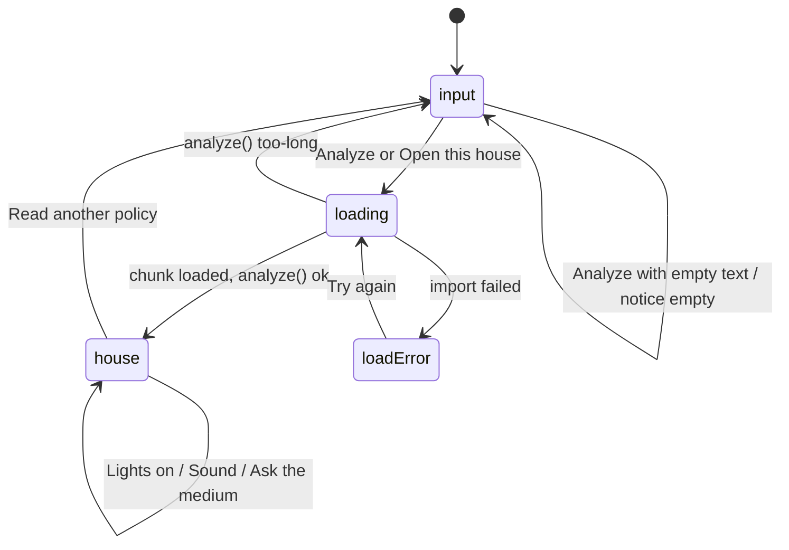

# Design: haunted-house-ui

## Overview

- The page is a server component. It reads `isLlmAvailable()` and renders one client component, `HauntedApp`, passing only that boolean.
- `HauntedApp` holds the app state in memory and shows either the input screen or the house view.
- The house view, the analyzer and the sample texts are loaded with a dynamic import on first use, so the first screen stays small.
- Ghosts are inline SVG buttons animated with CSS keyframes, which a reduced-motion media query switches off. Motion is used only for entrance fades, under `MotionConfig reducedMotion="user"`.
- Pure functions build the house model, the band label and the keyboard moves, so they can be property-tested.

Requirements: `.kiro/specs/haunted-house-ui/requirements.md` ("R9.3" means Requirement 9, criterion 3). Look and feel: `.kiro/steering/design-language.md`. Decisions: PLAN_DECISIONS.md C1.2, C1.3, C1.6, C1.8, C6, C10.

## Research behind the choices (16 November 2026)

| Fact | Source |
| --- | --- |
| `next/font` self-hosts fonts, so the browser sends no request to Google. `next/font/google` downloads the files at build time, though, so the repository would not hold the font files | `node_modules/next/dist/docs/01-app/01-getting-started/13-fonts.md` |
| `next/dynamic` and `React.lazy` both code-split client components. `ssr: false` works only inside client components | `.../02-guides/lazy-loading.md` |
| A prerendered page reads `process.env` at build time. `connection()` would defer to request time | `.../04-functions/connection.md`, `.../02-guides/environment-variables.md` |
| `motion/react` 14.14.0 exports `MotionConfig` (with `reducedMotion`), `useReducedMotion`, `LazyMotion`, `domAnimation` and `m` | Ran `import("motion/react")` |
| `@axe-core/playwright` 4.14.0 has `new AxeBuilder({ page }).withTags([...]).analyze()` | `node_modules/@axe-core/playwright/dist/index.d.ts` |

Decision from the font research: use **`next/font/local` with the font files committed** to `src/app/fonts/`, each with its `OFL.txt`. They are downloaded once, in Task 23, from the official `google/fonts` repository (`ofl/creepster`, `ofl/atkinsonhyperlegible`). This keeps "all assets in the repository" (rules R7) true, and no font request leaves the page (R1.4).

## Component tree and files

```
src/app/layout.tsx            fonts, <html lang="en">, skip link, <main id="content">, <Footer/>
src/app/page.tsx              server: llmAvailable = isLlmAvailable(); <HauntedApp llmAvailable={…}/>
src/app/fonts/                Creepster-Regular.ttf, AtkinsonHyperlegible-{Regular,Bold}.ttf, OFL-*.txt
src/components/
  HauntedApp.tsx              "use client". State machine; MotionConfig; lazy HouseView; error boundary
  InputScreen.tsx             textarea, counter, paste cap, empty message, Analyze button
  SampleCards.tsx             three cards from src/lib/samples/meta.ts (names and blurbs only)
  Footer.tsx                  "Not legal advice" notice
  ErrorBoundary.tsx           class component for R17.5
  house/HouseView.tsx         lazily loaded: Toolbar, ScoreBadge, Notices, House or LightsOnList, DetailDialog
  house/Toolbar.tsx           Read another policy · Lights on · Sound · sample name
  house/ScoreBadge.tsx        "<score> · <band>" plus live announcement
  house/Notices.tsx           non-English, no ghosts, only wisps, opt-in panel or the "no medium" line
  house/OptInPanel.tsx        "Ask the medium" button, OPT_IN_NOTICE, terms link, status messages
  house/House.tsx             frame SVG (aria-hidden) and the 8 rooms grid
  house/Room.tsx              heading, clause type, status text, ghost group (roving tabindex)
  house/Ghost.tsx             <button> with GhostArt, numeral and aria-label
  house/GhostArt.tsx          inline SVG ghost or wisp, sized by level
  house/DetailDialog.tsx      native <dialog>
  house/LightsOnList.tsx      plain semantic list
src/lib/ui/
  houseModel.ts               buildHouseModel, bandFor, severityLabel, ghostLabel, roomLabel
  roving.ts                   nextIndex(key, index, count)
  sound.ts                    createSound(): { enable(), play(severity) }
src/lib/samples/meta.ts       sample IDs, company names and blurbs (no policy text)
```

The analyzer and the sample texts are imported only from `HouseView`'s chunk (and from a `loadSample(id)` dynamic import), never from the input screen.

## State (`HauntedApp`)

```ts
type Source = { kind: "pasted" } | { kind: "sample"; id: "mild" | "average" | "terrible" };
type State =
  | { screen: "input"; text: string; notice?: "empty" | "cut" | "too-long" }
  | { screen: "loading"; text: string; source: Source }
  | { screen: "house"; text: string; source: Source; result: AnalyzeOk;
      ruleFindings: Finding[]; findings: ExplainedFinding[];
      mode: "house" | "lights"; sound: boolean;
      medium: "idle" | "listening" | "spoken" | { failed: Reason } }
  | { screen: "load-error"; text: string; source: Source };
```

- All state is React state. Nothing is written anywhere else (R1.6, R3.4).
- `ruleFindings` keeps the analyzer's own findings, so the panel can say "The medium raised this from 1 to 3" (R6.4).
- `findings` is what is shown: the rule findings merged with any medium's reading.
- The score is always `hauntScore(findings)` (R7.2).



## Page and `llmAvailable`

`page.tsx` is a server component that calls `isLlmAvailable()` from `server-only` code and passes the boolean (R14.1, C6). The page is prerendered, so the value is read at build time.
- On Vercel, environment variables exist at build time, and changing one triggers a redeploy, so this is correct.
- In E2E, each server is built with its own environment (see "E2E setup").
- Task 23 confirms that reading the variable in a prerendered page works with Cache Components on. If Next.js refuses, the fallback is to read it after `await connection()` inside a small `<Suspense>` boundary around the opt-in area only.

## Input screen (R2, R16.1, R16.2)

- `<textarea maxLength={50000}>`. The browser enforces the 50,001st-character block (R2.2). `onPaste` works out the length the text would have after the paste. If it is over 50,000, the handler takes over: it inserts the cut text itself and shows the "cut" notice in a `role="status"` region (R2.3).
- The counter is plain text, `aria-live="off"` (R2.6), formatted with `Intl.NumberFormat("en")`.
- An empty or whitespace-only text shows the message with `aria-invalid` and `aria-describedby` (R2.4).
- Sample cards are `<article>` elements, each holding an `h3` company name, a blurb and a button "Open this house" whose accessible name includes the company name.

## House and rooms (R4, R5, R9)

`buildHouseModel(findings)` returns eight `RoomModel`s in `ROOMS` order: `{ room, ghosts: Finding[] (sev ≥ 1), wisps: Finding[] (sev 0), items: Finding[] (input order), worst }`.

- **Grid:** `grid-cols-2` below `md` (768 px) and `md:grid-cols-4`. The DOM order is room order (R4.2).
- **Each room:**
  - `<section aria-labelledby>` with an `h3` room name in Creepster, the clause type, and a status line ("3 ghosts", "1 checked, looks fine", "Quiet").
  - Inside it, a `<div role="group" aria-label={roomLabel(model)}>` holds the buttons (R4.5).
  - A quiet room shows a dusty, empty room drawing with the visible "Quiet" text, and has no buttons (R4.3, R9.2).
- **Ghost buttons:**
  - Each is `<button type="button" data-severity data-finding-id tabIndex={active ? 0 : -1} aria-label={ghostLabel(f, room)}>`.
  - Inside are `GhostArt` (the SVG, `aria-hidden`) and a visible `<span>` numeral (R5.1–R5.3).
  - Level styles come from design-language.md: CSS custom properties `--ghost-size`, `--ghost-opacity` and `--ghost-colour` per `[data-severity]`. The button has `min-width` and `min-height` of 44 px (R5.5) and a `focus-visible` outline in candle-amber, 3 px with a 2 px offset (R5.6).
- **Roving tabindex (C1.8):**
  - Each room keeps `activeIndex` in state, starting at 0 (R9.1).
  - `onKeyDown` on the group calls `nextIndex(key, i, n)`, which returns the new index or `null`. ArrowRight and ArrowDown give `(i+1) % n`; ArrowLeft and ArrowUp give `(i-1+n) % n`; Home gives 0; End gives `n-1`; any other key gives `null` (R9.3).
  - On a new index, the handler calls `preventDefault`, sets the index and focuses that button.
  - `onFocus` on a button sets `activeIndex` to it, so a click or Tab return remembers it (R9.4).
  - Tab is left to the browser, so it moves to the next tab stop, which is the next non-quiet room (R9.5).
- **Frame:** a hand-drawn SVG roofline, beams and stairs, `aria-hidden="true"`, with no information of its own (R4.6). It sits behind the grid and never overlaps the buttons' hit areas.

## Ghost art and motion (R5.4, R10)

- `GhostArt` is one SVG path (a sheet ghost with eyes). Level 0 is a smaller wisp path.
- **Animation:** CSS keyframes `hc-drift` (level 0), `hc-bob` (1), `hc-bob-sway` (2) and `hc-bob-sway-glow` (3), with the amplitudes and durations from design-language.md. The glow is a slow opacity pulse on a blurred copy, under 0.5 Hz, so far below the 3-flashes-per-second limit (R10.4).
- **Reduced motion:** `@media (prefers-reduced-motion: reduce) { .hc-ghost, .hc-ghost * { animation: none !important; transition: none !important; } }` (R10.2, R10.3).
- **Motion library:** used only for fade-ins of the house view and the dialog content (`m.div` with `LazyMotion features={domAnimation}`, to keep it small), under `MotionConfig reducedMotion="user"`, which drops transforms when reduced motion is on.
- **Delays:** ghost animation delays are derived from each finding's ID with a stable hash, so ghosts do not move in step and the result stays deterministic. There is no randomness.

## Detail panel (R6, R13)

- **Opening:** a native `<dialog aria-labelledby="dlg-title">` opened with `showModal()`, which gives focus containment and makes the rest of the page inert (R6.7).
- **Content, in order:**
  1. Room name (`h2#dlg-title`).
  2. A severity chip (numeral and label).
  3. "The clause" with a `<blockquote>` holding `quote` as a text node, `white-space: pre-wrap` and `overflow-wrap: anywhere` (R6.2, R6.5).
  4. The explanation.
  5. "Why it matters" and its text.
  6. Mitigation notes (R6.3).
  7. The medium-raised note (R6.4).
  8. The source badge.
  9. "Not legal advice".
  10. A "Close" button.
- **Closing:** the `cancel` event (Escape) and the Close button both call `close()`. On `close`, focus goes back to the stored opener element (R6.6).
- **Size:** `max-height: calc(100dvh - 2rem)` with `overflow-y: auto`, and `width: min(36rem, calc(100vw - 2rem))` (R12.3).
- All texts render as React text children. No `dangerouslySetInnerHTML` exists anywhere in the app (R6.5).

## Score (R7)

- `ScoreBadge` shows `` `${score} · ${bandFor(score)}` `` with the band in Creepster. There is no "/100" anywhere (R7.1).
- A separate visually hidden `role="status"` element gets "Haunt Score N, band" only when the score changes, using a ref to the previous value (R7.3).

## Lights on mode (R8)

- **Toggle:** a button with `aria-pressed`. Its text stays "Lights on" in both states, and its pressed state says whether the lights are on (R8.1). Focus stays on it, because the toggle is not unmounted (R8.5).
- **List:** `LightsOnList` renders `<section>` per room, with an `h3` per room in room order. Under each is an `<ol>` of findings, each holding the severity numeral and label, the quote in `<blockquote>`, the explanation, "Why it matters" and the badge. A quiet room shows "Quiet" (R8.2).
- It is built from the same `buildHouseModel(findings)` as the house, so both views show the same findings (R8.3, property U1).
- It has no SVG, no animation classes and no Motion components (R8.4). "Not legal advice" sits at the top (R13).

## Opt-in (R14) and samples (R15)

- **Opt-in panel:** `OptInPanel` renders only when `llmAvailable && source.kind === "pasted" && findings.length > 0` (R14.1, R14.3). It shows the button, `OPT_IN_NOTICE` and the terms link.
- **When `llmAvailable` is false:** `Notices` shows the "no medium" line instead (R14.2).
- **On press:**
  1. Set `medium: "listening"` and disable the button, with the live region saying "The medium is listening…".
  2. Call `requestExplanations(ruleFindings)` from llm-explainer (R14.4). It is called only from this button's handler. There is no effect hook or timer that could call it (R14.7).
  3. On `llm`: `findings = mergeFindings(ruleFindings, result.findings)`, `medium: "spoken"`, announce, hide the button (R14.5).
  4. On `rules`: keep the findings, `medium: { failed: reason }`, show the message, re-enable unless `no-key` (R14.6).
- **Samples:** `loadSample(id)` dynamically imports the sample text and `sampleReading(id)`. `findings = mergeFindings(analyze(text).findings, reading.llmFindings)`. Badges follow `source` on each finding (R15.1). The toolbar shows "Sample: <company> (a fictional company)" (R15.3).
- **No fetch for samples:** no fetch happens on any sample path (R15.2).

## Sound (R11)

- **Creating the context:** `sound.ts` creates an `AudioContext` only inside `enable()`, which runs from the Sound toggle's click handler (a user gesture) (R11.1).
- **The tone:** `play(severity)` plays one oscillator note. The pitch drops with severity (0: 660 Hz, 1: 520 Hz, 2: 390 Hz, 3: 260 Hz), the note lasts 450 ms with an exponential gain fade, and the peak gain is 0.08. It is called only when a detail panel opens while sound is on (R11.3).
- No audio files are shipped (R11.4).

## Edge, loading and error states (R16, R17)

- The non-English notice, "No ghosts here" and "Only calm wisps here" come from `Notices`, driven by `result.likelyNonEnglish` and `buildHouseModel` (R16.3–R16.5).
- A `too-long` result returns to the input screen with notice `too-long` (R16.6).
- `HouseView` is `lazy(() => import("./house/HouseView"))` inside `<Suspense fallback={<Loading/>}>`. The fallback shows "Opening the house…" and sets `aria-busy` on `<main>` (R17.1, R17.2).
- **Import failure:** the import is wrapped in a retryable loader (`createRetryableImport`) that clears its cached promise after a failure, so "Try again" really imports again (R17.3).
- `ErrorBoundary` catches render errors in the house view and shows the same message (R17.5).
- "Read another policy" sets `screen: "input"`, keeping `text` for pasted input and clearing it after a sample (R17.4).

## Performance (R18)

The first load holds only the layout, `HauntedApp`, `InputScreen`, `SampleCards`, `Footer`, the sample metadata and the fonts. These stay out of the first load: the house view, the analyzer, Zod and the llm client, Motion components, and the sample texts. The E2E test measures the real numbers (see "Testing"), and the result is recorded in tech.md, replacing the "to be confirmed" note.

## Pure functions and their properties

```ts
buildHouseModel(findings: Finding[]): RoomModel[]       // always 8, in ROOMS order
bandFor(score: number): "Mostly quiet" | "Uneasy" | "Haunted" | "Run"
severityLabel(s: Severity): string
ghostLabel(f: Finding, room: Room): string
roomLabel(model: RoomModel): string
nextIndex(key: string, index: number, count: number): number | null
```

All properties use `fc.assert(..., { numRuns: 1000 })`.

| # | Property | Requirement | Test file |
| --- | --- | --- | --- |
| U1 | For any findings, `buildHouseModel` returns exactly 8 rooms in `ROOMS` order. Every finding appears in exactly one room (its own), and within each room in input order. Ghosts are exactly the findings with severity ≥ 1 and wisps those with 0 | R4.1, R4.4, R8.3 | `houseModel.property.test.ts` |
| U2 | `bandFor` is defined for every whole number 0–100, never moves to a lower band as the score rises, and matches the band table at 0, 24, 25, 49, 50, 74, 75 and 97 | R7.1 | `houseModel.property.test.ts` |
| U3 | For any `count` ≥ 1, any start index in range and any sequence of keys, `nextIndex` keeps the index in `[0, count)`. Each arrow key followed by its opposite returns to the start, and Home and End give 0 and `count − 1` | R9.3 | `roving.property.test.ts` |
| U4 | For any findings, every `ghostLabel` names the finding's own room and severity, and the labels within a room are in the same order as the buttons | R5.2 | `houseModel.property.test.ts` |

Findings for U1 and U4 come from `analyze()` on the analyzer's `policyLike` generator, plus arbitrary `{ room, severity }` lists.

## E2E setup

Playwright runs two production servers:

| Project | Port | Build | Purpose |
| --- | --- | --- | --- |
| `no-key` | 3100 | `.next`, `GEMINI_API_KEY` empty | Every flow, samples, keyboard, motion, layout, axe, edge states, performance, the no-key route |
| `llm-ui` | 3101 | `HC_DIST_DIR=.next-e2e-llm`, `GEMINI_API_KEY=placeholder-e2e-not-a-real-key`, `HC_SKIP_PRECOMPUTE=1` | The opt-in UI with `llmAvailable` true. Every `/api/explain` call is answered by `page.route` stubs in the browser, so the server never contacts Google |

- `next.config.ts` gets `distDir: process.env.HC_DIST_DIR || ".next"`, so the second build does not overwrite the first.
- The placeholder value starts with "placeholder", so the secret scanner's placeholder rule ignores it, and it is not key-shaped.
- The `llm-ui` project also runs a guard test: it fails if any request leaves the browser for a host other than `localhost`.
- `.next-e2e-llm` is added to `.gitignore`. Folders under `.kiro` are not affected.

E2E tests import the analyzer and samples directly (`../src/lib/analyzer`) to compute the expected rooms, severities and score, so the browser result is compared with the pure function's result. This needs the analyzer and sample modules to use relative imports only, which the clause-analyzer design already requires for its purity rule.

## Testing

**Component tests (Vitest and Testing Library):**

| File | Covers |
| --- | --- |
| `InputScreen.test.tsx` | Counter format; `maxLength`; paste over the cap is cut with the notice; the empty message with `aria-invalid`; the Analyze callback |
| `SampleCards.test.tsx` | Three cards; buttons named with the company |
| `Ghost.test.tsx` | Each level 0–3: `data-severity`, aria-label, visible numeral, the level class; 44 px minimum |
| `Room.test.tsx` | Quiet room text and no buttons; the status line; the group label; roving tabindex (one `tabindex=0`; arrows, Home and End move focus; wrap-around; focus memory) |
| `DetailDialog.test.tsx` | All fields; mitigation notes; the medium-raised note; plain text (a quote holding `<b>` shows literally); Close returns focus |
| `ScoreBadge.test.tsx` | Format "N · band"; no "/100"; the announcement only on change |
| `LightsOnList.test.tsx` | Same findings as the model; Quiet rooms; no SVG; the notice at the top |
| `OptInPanel.test.tsx` | Hidden when `llmAvailable` is false (the "no medium" line shown); hidden for samples; listening state; the success merge; each failure message; no call without a press |
| `Footer.test.tsx` | "Not legal advice" |
| `sound.test.ts` | No `AudioContext` before `enable()`; pitch per severity; duration ≤ 600 ms (mocked `AudioContext`) |
| `houseModel.test.ts`, `roving.test.ts` | Examples, plus properties U1–U4 |

**E2E tests (Playwright):**

| Spec | Project | Covers | Requirements |
| --- | --- | --- | --- |
| `flow.spec.ts` | no-key | For each sample: open it; 8 rooms in order; per-room counts, `data-severity` and score equal the analyzer's; open a ghost, and the quote equals `text.slice(start, end)` with the right badge; no request to `/api/explain` (request listener); Read another policy. Pasted text: type a short policy, Analyze, and see the house | R3, R4, R5, R6, R7, R15 |
| `keyboard.spec.ts` | no-key | Terrible sample: Tab visits the 8 rooms in order (one stop each); arrows, Home and End reach every ghost in each room; Enter opens, Escape closes, and focus returns to the same ghost; Tab after a ghost goes to the next room | R9 |
| `lights.spec.ts` | no-key | Same findings as the house for all samples; Quiet rooms; focus stays on the toggle | R8 |
| `optin.spec.ts` | llm-ui | Button and notice shown for pasted text; hidden for samples; stub success updates the badges and the score; stub failures (`rate-limited`, `timeout`, network abort) keep the rules and show the messages; the request body holds only flagged-clause text (every `text` is a substring of a finding quote, and the unflagged sentences are absent); no request before the press | R14 |
| `optin-hidden.spec.ts` | no-key | The button is absent; the "no medium" line is shown | R14.2 |
| `motion.spec.ts` | no-key | With `reducedMotion: "reduce"`, every `.hc-ghost` has `animation-name: none`; without it, level 3 ghosts have a running animation; sound off on load and no `AudioContext` constructed (an init script counts constructor calls) | R10, R11 |
| `layout.spec.ts` | no-key | 360 × 740 and 1440 × 900 on the input screen, each sample house, an open dialog and Lights on: no horizontal scroll; 2 or 4 grid columns | R12 |
| `a11y.spec.ts` | both | The axe scan of every state in R19.1, with `withTags(["wcag2a","wcag2aa","wcag21a","wcag21aa","wcag22aa"])`, failing on serious or critical | R19 |
| `edge.spec.ts` (Phase 5) | no-key | Empty input; exactly 50,000 characters; the 50,001st blocked; a 60,000-character paste cut with the notice; a Spanish and a Japanese paragraph show the notice; a policy with no risky clauses shows "No ghosts here"; a wisps-only policy | R2, R16 |
| `loading.spec.ts` (Phase 5) | no-key | Block the house chunk with `page.route`, see the error and "Try again", unblock, retry, and the house opens with the text kept | R17 |
| `perf.spec.ts` (Phase 5) | no-key | A CDP session with `Network.emulateNetworkConditions` (latency 150 ms, download 200,000 B/s, upload 93,750 B/s) and the cache disabled: the textarea accepts typing within 5 s; the sum of `encodedDataLength` for JS responses before any action is ≤ 200 kB, and is printed | R18 |

Coverage target: 80% of lines for `src/` outside the analyzer and llm folders, enforced in `vitest.config.mts`.

## Error handling summary

| Situation | What the user sees |
| --- | --- |
| Empty text | Message by the textarea, stays on input |
| Paste over the cap | Text cut at 50,000 and the notice |
| Analyzer `too-long` | Input screen with the message |
| House chunk fails to load | Error message and "Try again", with the text kept |
| Render error in the house | Error boundary message |
| Medium fails or is limited | The rule reading stays, with a short message |
| `llmAvailable` false | No opt-in button, and the "no medium" line |
