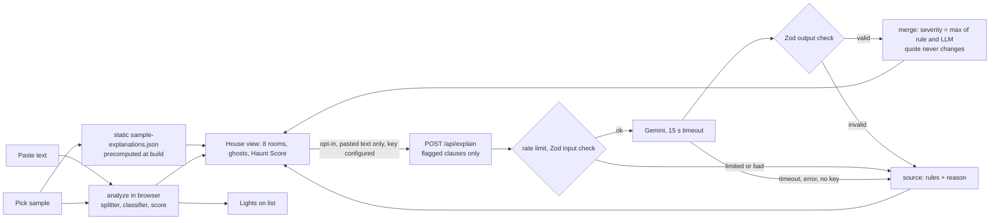

# PLAN_DECISIONS.md

Decisions the user approved after writing PLAN.md. Where this file and PLAN.md conflict, this file wins. Known conflicts:

- Phase 1 approval stops: one per spec, after its design, instead of two.
- Agent wording: "no write tool; shell limited to build/test commands" instead of "read-only".
- Samples use precomputed explanations and never call the API at runtime.

Re-read PLAN.md and this file at the start of every phase and after every context compaction.

## C1. Decisions approved by the user

1. **LLM provider: Google Gemini.**
   - SDK: `@google/genai` (Apache-2.0).
   - Env vars: `GEMINI_API_KEY` (required for the LLM path) and `GEMINI_MODEL` (optional). The default model ID is checked through Context7 or the Gemini docs in Phase 3.
   - Gemini structured output accepts a JSON Schema. Generate it from the Zod schema, and still validate every response with Zod on the server.
2. **Gemini data handling.**
   - For pasted text, the live LLM call is opt-in. A clearly labelled button comes with a notice that the flagged clauses will be sent to Google, which may keep them under free-tier terms.
   - Only the clauses the classifier flagged are sent, never the full text.
   - DEPLOY.md recommends a billing-enabled (paid-tier) key.
   - The app works fully with no key. In that case the button is hidden and a line of text explains that rule-based readings are shown.
   - Source: aistudio.google.com/docs/terms, "Unpaid Services". On the free tier, Google uses content to improve products and human reviewers may read it. Paid services do not.
3. **Samples use precomputed explanations and never call the API at runtime.**
   - `scripts/precompute-samples.mts` runs as an npm `prebuild` step and also as `npm run precompute:samples`.
   - When `GEMINI_API_KEY` is set, it runs each of the three samples through the same pipeline as the route: analyzer, flagged clauses, provider, Zod, then merge. It writes `src/lib/samples/sample-explanations.json` with `source: "llm"`.
   - When no key is set, or on any failure, it writes or keeps the rule-based content (`source: "rules"`) and exits 0. The build must never fail because of this step.
   - The committed version of the file holds the rule-based content, because the builder has no key. The user regenerates it after adding a key (see manual steps). On Vercel, the key is present at build time, so the deployed build gets Gemini explanations.
   - The JSON is validated against the Zod schema when it is imported. A consistency test checks that its clause IDs match the current analyzer output for each sample, so drift fails the tests.
   - A UI E2E test proves that picking a sample makes no request to `/api/explain`.
4. **Rate limit.**
   - In memory, per server instance, sliding window, 10 requests per minute per IP. When the limit is hit, the response is the rule-based result with `reason: "rate-limited"`.
   - Client IP, verified from Vercel docs (vercel.com/docs/headers/request-headers): Vercel overwrites `x-forwarded-for` and does not forward external IPs, to prevent spoofing. `x-vercel-forwarded-for` is identical but is not overwritten by a proxy placed in front of Vercel.
   - Order of use: `x-vercel-forwarded-for`, then the first value of `x-forwarded-for`, then `x-real-ip`, then a shared `"unknown"` bucket.
   - The executor re-reads that Vercel page in Phase 3 and cites it in a code comment and in DEPLOY.md.
   - DEPLOY.md states plainly that the limit is best-effort: each serverless instance keeps its own count, counts reset on cold start, and instances do not share counts.
5. **Kiro app: Kiro IDE.** Hooks use native triggers:
   - `FileSave` for Test on save, Secret guard and Rules guard.
   - `PostTaskExecution` for Spec sync.
6. **Visual direction: Victorian gothic.**
   - Palette: deep aubergine, ink-black, candle-amber, and sickly green for severity 3.
   - Fonts: Creepster for headings only (not Nosifer) and Atkinson Hyperlegible for body text. Both are under the SIL Open Font License and are self-hosted through `next/font`, with no runtime request to Google.
7. **Mitigations and exception markers.** A mitigating phrase (for example "we do not sell") lowers severity only when no exception marker follows it in the same clause. The markers are: `except`, `unless`, `other than`, `however`, `provided that` (extended in C10.2 with `but`, `although`, `subject to`). Matching is case-insensitive and on word boundaries. Add tests for each marker, for a marker that comes before the mitigation (the mitigation still applies), and for a marker in a different clause (the mitigation still applies).
8. **Keyboard navigation in the house: roving tabindex.**
   - Each room that has ghosts is exactly one tab stop. Arrow keys (Left/Right and Up/Down) move between the ghosts in that room. Home and End jump to the first and last ghost. Enter or Space opens the detail panel. Escape closes it and returns focus to the same ghost. Tab moves to the next room, not the next ghost.
   - Rooms with no ghosts are not tab stops. Their "Quiet" status is visible text, is announced in each room's accessible name, and appears in Lights on mode.
   - E2E keyboard tests for the terrible sample: Tab visits all eight rooms in order, arrow keys reach every ghost in a room, and the Enter, Escape and focus-return cycle works.
9. **Agent wording.** Describe the verification agents everywhere as "no write tool; shell limited to build/test commands". Never call them "read-only". This applies to the agent files, steering, BUILD_LOG.md, README, docs/KIRO_USAGE.md, docs/DEVPOST_DESCRIPTION.md, the blog and social drafts, and COMPLETION_REPORT.md. PLAN.md itself stays unchanged.
10. **Splitter abbreviations.** The splitter never ends a clause after these: `e.g.`, `i.e.`, `Inc.`, `Ltd.`, `Co.`, `Corp.`, `U.S.`, `No.`, `Sec.`, `etc.`, `vs.`. A paragraph break still splits. Add a unit test for each abbreviation used mid-sentence, plus one for `etc.` followed by a paragraph break.
11. **LICENSE:** MIT, "Copyright (c) 2026 Soham Banerjee".
12. **Phase 1 approval:** one stop per spec, after its design. At each stop, show the requirements and the design together and wait for approval before writing that spec's tasks and moving on. (Changed for clause-analyzer only; see C10.1.)
13. **Submission period:** open. Start Phase 0 immediately.

## C2. Remaining assumptions

- Framer Motion is now published as `motion` (MIT, imported from `motion/react`). Use `motion` and note the rename in BUILD_LOG.md.
- The builder saves each verification agent's full report, unchanged, to `docs/gate-reports/phase-N-<agent>-attempt-K.md`, and appends a summary (verdict, attempt number, problems) to BUILD_LOG.md.
- Sound is synthesised in code with the Web Audio API, so there are no audio asset files. Sound is off by default.

## C3. Architecture

The analyzer runs in the browser, so pasted text never leaves the device unless the user opts in.

## C4. Analyzer design (spec: clause-analyzer)

- **Splitter:**
  - Returns `Clause{id, start, end, text}`, where `text === input.slice(start, end)` and the spans are contiguous. Joining all clause texts gives back the input exactly.
  - It splits at paragraph breaks, list markers, and `. ; ? !` followed by whitespace.
  - It never splits after the abbreviations listed in C1.10.
  - IDs are `c-<start>`.
- **Classifier:**
  - A data table of patterns per room. Each pattern has a severity, an explanation template and a "why it matters" template.
  - Mitigating phrases lower the severity, subject to the exception markers in C1.7.
  - Each clause is classified on its own, with no `Date` and no randomness.
- **Severity levels:** 0 means the clause matches a room but looks fine; it shows as a faint wisp, which tells the user the clause was checked. Levels 1 to 3 are ghosts of rising intensity.
- **Haunt Score:**
  - Per-severity weights are 0, 0.05, 0.15 and 0.30.
  - The score is `round(100 × (1 − Π(1 − w)))`, multiplying over all findings.
  - It is always a whole number from 0 to 100, and adding a finding can never lower it.
- **Input limits:** Input over 50,000 characters returns a typed error result instead of throwing. A non-English check (few English stopwords) sets a flag, and the UI then shows a notice.
- **Properties:** The six from PLAN.md section 4, each run with `fc.assert(..., { numRuns: 1000 })`. The monotonic property inserts the risky clause at a clause boundary (for example joined with `"\n\n"`).

## C5. LLM explainer design (spec: llm-explainer)

- **Input:** At most 40 clauses, each at most 1,500 characters, validated with Zod.
- **Output:** `{findings:[{id, plainEnglish ≤400, whyItMatters ≤400, severity 0–3}]}`. The route returns `{source: "llm" | "rules", reason?: "no-key" | "timeout" | "invalid" | "rate-limited" | "error" | "bad-request", findings}`.
- **Merge rules:**
  - IDs the server did not send are dropped.
  - Severity becomes `max(rule, llm)`.
  - The quote always comes from the analyzer.
- **Prompt injection:** Clause text is treated as data in the system instruction, and explanations are rendered as plain text, never as HTML.
- **Server-only code:** `import "server-only"` keeps the provider code out of the browser bundle. The route handler is built by a factory (`createExplainHandler({ provider, rateLimiter, now })`) so tests can pass in mocks.
- **Logging:** Only reason codes are logged, never request bodies or clause text.
- **Route settings:** `runtime = "nodejs"`. Set `maxDuration` after checking the current Vercel free-plan limit in the docs; it must allow 15 seconds plus overhead.
- **Precompute:** The sample precompute script (C1.3) reuses the provider, schema and merge code.
- **Properties:**
  - Merging never lowers a severity.
  - Merging never changes a quote.
  - The merged result has the same IDs as the rule-based result.
  - Any JSON at all (`fc.anything()`) falls back to the rules result without throwing.

## C6. UI design (spec: haunted-house-ui)

- **Input screen:**
  - A textarea with a live character counter and a hard 50,000 cap.
  - Three sample cards. Picking one loads its static precomputed explanations.
  - An Analyze button.
  - The house view is loaded with a dynamic import, which keeps the first screen light.
- **House layout:** An SVG and CSS house with eight rooms, 2 columns × 4 rows on mobile and 4 × 2 on desktop. A room with no findings is drawn as calm and dusty, with the text "Quiet".
- **Ghosts:**
  - Each ghost is a `<button>` with `data-severity` and an aria-label such as "Severity 3 ghost in The Cellar".
  - Intensity is shown by size, opacity, colour, motion amplitude and a visible numeral, so colour is never the only signal.
  - Keyboard behaviour follows C1.8.
- **Detail panel:** Built on the native `<dialog>` element. It shows the exact quote, the plain-English explanation, why it matters, the severity, and a source badge reading "Rule reading" or "Medium's reading".
- **Haunt Score:** Shown as a number plus a band label:
  - 0–24: Mostly quiet
  - 25–49: Uneasy
  - 50–74: Haunted
  - 75–100: Run
- **Lights on mode:** A toggle switches to a plain, semantic list of the same findings.
- **Motion:** `MotionConfig reducedMotion="user"` plus a CSS `prefers-reduced-motion` media query.
- **Sound:** Off by default (see C2).
- **Page chrome:** A skip link, and a "Not legal advice" notice in the footer and the detail panel.
- **LLM availability:** The server passes only `llmAvailable: boolean` to the page, never the key.

## C7. Expected sample results

These are fixtures, checked in both unit and E2E tests.

- Mild sample: score ≤ 25.
- Average sample: score 35–65.
- Terrible sample: score ≥ 80, with at least one ghost in every room.
- All three are fictional companies with invented names. Web-search each name to confirm it is not a real company, and record the check in BUILD_LOG.md.

## C8. Tooling

- **Tests:** Vitest with `@vitest/coverage-v8`, Testing Library with jsdom, fast-check, Playwright, and `@axe-core/playwright` (MPL-2.0, listed in the README licenses).
- **Coverage thresholds**, enforced in the Vitest config:
  - `src/lib/analyzer/**`: 90% of lines.
  - `src/lib/llm/**`: 90% of lines.
  - Everything else: 80% of lines.
- **E2E setup:** Tests run against `next build && next start` with no key. The pasted-text LLM path is stubbed in the browser with `page.route`.
- **Scripts in `scripts/`:**
  - `secret-scan.mjs` scans files, the staged diff, or STDIN (for `git log -p --all`). It detects Google keys (`AIza…`), private key blocks, `sk-` style keys, and env assignments that look like keys.
  - `check-repo-rules.mjs` runs `git check-ignore` on paths inside `.kiro`, checks the MIT LICENSE text, and checks that `.env.example` is tracked with no value set.
  - `test-related.mjs` reads the hook's STDIN JSON and runs `vitest related <file> --run`.
  - `check-bundle.mjs` builds with a canary key, then searches `.next/static` for both the canary and the variable name.
  - `precompute-samples.mts` is described in C1.3.
- **Fake keys in test fixtures** are assembled at runtime by joining strings. Otherwise the secret guard and GitHub push protection would flag the test files.
- **`.gitignore`:** `.env*` then `!.env.example`, plus `.next`, `node_modules`, `coverage`, `playwright-report`, `test-results` and `.vercel`. It must contain nothing that matches `.kiro`, including broad patterns such as `.*`.
- **MCP:** `.kiro/settings/mcp.json` has Context7 (`@upstash/context7-mcp`) and Playwright MCP (`@playwright/mcp`), both pinned to versions checked with `npm view`. No API keys go in this file.
- **Agents:** Markdown files in `.kiro/agents/`.
  - No agent has the `write` tool.
  - Shell permissions are limited to build and test commands: `npm run test*`, `npm run build`, `npm run lint`, `npm run typecheck`, `npm run check:*`, `npx playwright test`, `npx vitest`, `npm audit`, `npx license-checker`, `git log`, `git ls-files`, `git check-ignore` and `git show`.
  - ui-a11y-reviewer also gets the Playwright MCP tools.
- **Linting:** Recent Next.js removed `next lint`, so the `lint` script runs `eslint .`.
- **Scaffolding:** `create-next-app` refuses to run in a folder holding PLAN.md. Scaffold into a temporary folder and move the files in.

## C9. User's manual steps (do not do these; prepare for them)

1. Get a Gemini API key (paid tier recommended) and put it in `.env.local`.
2. Run `npm run precompute:samples`, check `src/lib/samples/sample-explanations.json`, and commit it.
3. Create the public GitHub repository and push.
4. Deploy to Vercel and set `GEMINI_API_KEY` (and `GEMINI_MODEL` if wanted), following docs/DEPLOY.md.
5. Record the demo video from docs/VIDEO_SCRIPT.md and upload it to YouTube.
6. Rewrite docs/KIRO_USAGE.md in his own words.
7. Fill in and submit the Devpost form, using docs/DEVPOST_DESCRIPTION.md.
8. Publish docs/BLOG_DRAFT.md and docs/SOCIAL_POST.md.

## C10. Changes approved during Phase 1 (16 November 2026)

1. **Approval stops.** clause-analyzer has two stops: after requirements and after design (the user's instruction at the start of Phase 1). llm-explainer and haunted-house-ui keep one stop each, showing requirements and design together (C1.12).
2. **Exception markers extended.** The markers are now eight: `except`, `unless`, `other than`, `however`, `provided that`, `but`, `although`, `subject to`. Each marker has its own test. A test must show that "We do not sell your data, but we may share it with advertising partners." is not lowered to severity 0.
3. **Room examples.** At least three positive and two negative example clauses per room, all listed in the clause-analyzer design, each with its own test (Requirement 2.7).
4. **Haunt Score check.** The design must compute the score for a realistic long policy (about 150 clauses, mostly severity 0 and 1 findings) and, if long policies land at 95 or above, propose adjusted weights that keep the six properties and the sample bands. Outcome: see the clause-analyzer design, section "Haunt Score". The weights stay as in C4 until the user approves a change.
5. **Splitter boundary rule.** The design must state which rule wins when an indented list item follows a paragraph break (Requirement 1, criteria 8 and 9).

## D. Task map (spec tasks.md files must match these ranges)

- Phase 0: Tasks 1–6 (scaffold, steering, guard scripts, hooks and MCP, agents, Gate 0).
- Phase 1: Tasks 7–10 (three specs, one approval stop each after design; Gate 1).
- Phase 2 (clause-analyzer tasks.md): Tasks 11–16.
- Phase 3 (llm-explainer tasks.md): Tasks 17–22.
- Phase 4–5 (haunted-house-ui tasks.md): Tasks 23–33.
- Phase 6: Tasks 34–35 (README, DEPLOY.md, drafts, Gate 6).
- Phase 7: Task 36 (COMPLETION_REPORT.md and final message).

The full task text is in the execution handoff the user approved; the summary of each task is reproduced in the spec tasks.md files when they are written.
